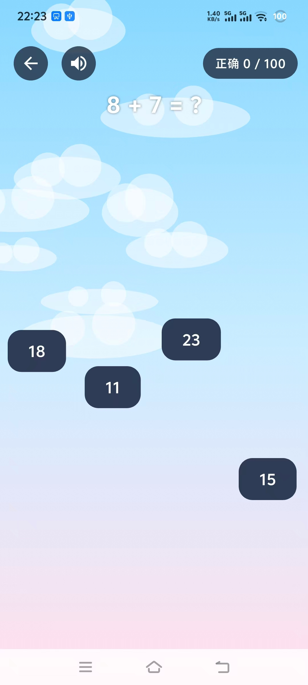

# 【极速算数】Flutter 下落答题小游戏


> 把枯燥的口算练习，变成一场需要眼疾手快的反应力挑战。

## 项目简介

【极速算数】是一款基于 **Flutter + Flame** 引擎实现的下落答题小游戏。针对传统计算练习枯燥、缺乏反馈的问题，将四则运算训练与实时反应力玩法结合：题目固定在屏幕顶部，答案方块从上方不断坠落，玩家需要在正确答案掉出屏幕前准确点击它。游戏在有限时间内同时考验心算速度与手眼协调能力，并通过逐级提升的题目难度持续制造挑战。

## 游戏截图

| 主界面 | 游戏进行中 |
| :---: | :---: |
|  |  |
| 渐变天空背景、历史最高分与错题本入口 | 四赛道坠落、顶部实时题目与计分 HUD |

## 核心玩法

1. 屏幕顶部居中显示当前题目，四个答案方块从上方沿不同赛道坠落。
2. 点击正确答案：方块清空、答对数 +1，立即进入下一题。
3. 点击错误答案或正确答案掉落屏幕：本局结束。
4. 累计答对 **100 题**即可通关。

## 核心功能

- **多赛道动态坠落**：屏幕均分为 4 条垂直赛道，1 个正确答案与 3 个干扰项随机分配到不同赛道中央；初始高度与下落速度带随机偏移，形成互不重叠的多轨迹效果。
- **难度逐级递增**：题目生成器根据当前答对题数选择运算类型与数值范围，从一位数加减逐步过渡到两位数乘除，保证难度曲线平滑且答案长度可控。
- **动态干扰项**：错误选项基于正确答案的位数生成相近量级的数值，并过滤重复项与负数，避免出现一眼看穿的离谱选项。
- **错题本记录**：答错或正确答案落底时记录题目、你的答案与时间；错题与最高成绩通过 `shared_preferences` 本地持久化，重启应用后仍可查看历史错题。
- **卡通视觉与音效**：纯代码绘制的天空渐变背景与循环漂浮云朵，搭配背景音乐、点击音效与失败音效，并支持一键开关声音。
- **完整游戏流程**：主菜单、游戏 HUD、结束弹窗、错题本覆盖层，支持重新开始、返回主菜单以及在游戏中二次确认退出。

## 技术栈

| 分类 | 技术 |
| --- | --- |
| 客户端框架 | Flutter、Dart |
| 游戏引擎 | Flame（组件化渲染、Game Loop、Overlay） |
| 状态管理 | 游戏状态机（`playing` / `gameOver`）+ `ValueNotifier` 驱动 HUD |
| 题目生成 | 基于答对题数的动态难度算法、随机干扰项生成 |
| 本地存储 | `shared_preferences` + JSON 序列化 |
| 音频 | `flame_audio`（BGM / 点击音效 / 失败音效） |

## 难度设计

题目由 `QuestionGenerator` 根据当前 `correctCount` 动态生成：

| 答对题数 | 运算符 | 数值范围 |
| :---: | :---: | --- |
| 1 - 10 | `+` `-` | 两个 1 位数 |
| 11 - 20 | `+` `-` | 1 位数与 2 位数 |
| 21 - 30 | `*` `/` | 两个 1 位数 |
| 31 - 50 | `+` `-` | 两个 2 位数 |
| 51 - 70 | `*` `/` | 1 位数与 2 位数 |
| 71 - 100 | `*` `/` | 受控范围内的两位数运算 |

生成规则内含健壮性处理：减法保证大数在前避免负数，除法通过“除数 × 商”反推被除数确保整除，高位运算限制数值范围避免答案过长溢出屏幕。

## 项目结构

```text
falling_quiz_game/
├── lib/
│   ├── main.dart                    # 应用入口，挂载 GameWidget 与 Overlay
│   ├── components/
│   │   ├── background.dart          # 渐变天空 + 漂浮云朵背景组件
│   │   └── falling_answer.dart      # 坠落答案方块组件（Tap / 下落 / 落底）
│   ├── game/
│   │   └── quiz_game.dart           # 核心游戏类：状态机、赛道生成、HUD、各 Overlay
│   ├── models/
│   │   ├── question.dart            # 题目模型
│   │   ├── question_generator.dart  # 动态难度题目与干扰项生成
│   │   └── wrong_record.dart        # 错题记录模型
│   └── utils/
│       └── storage.dart             # SharedPreferences 本地持久化封装
├── assets/audio/                    # 背景音乐与音效
├── docs/screenshots/                # README 游戏截图
└── pubspec.yaml
```

## 本地运行

### 环境要求

- Flutter SDK 3.x（含 Dart 3.x）
- Android Studio / Android SDK
- 已连接的 Android 真机或模拟器
- 首次运行前可通过 `flutter doctor` 检查环境

### 运行步骤

```bash
# 1. 克隆仓库
git clone <repository-url>
cd falling_quiz_game

# 2. 安装依赖
flutter pub get

# 3. 启动应用（自动选择已连接设备）
flutter run
```

如需指定设备：

```bash
flutter devices
flutter run -d <device-id>
```

### 构建安装包

```bash
flutter build apk --release
```

产物位于 `build/app/outputs/flutter-apk/app-release.apk`。

## 说明

- `assets/audio/` 下的音频为占位素材，可直接替换为同名文件。
- 新增包含原生代码的插件后，请完整重新运行应用（必要时执行 `flutter clean && flutter run`），热重载不会重新注册原生插件。
- 本项目用于学习实践与面试展示。
